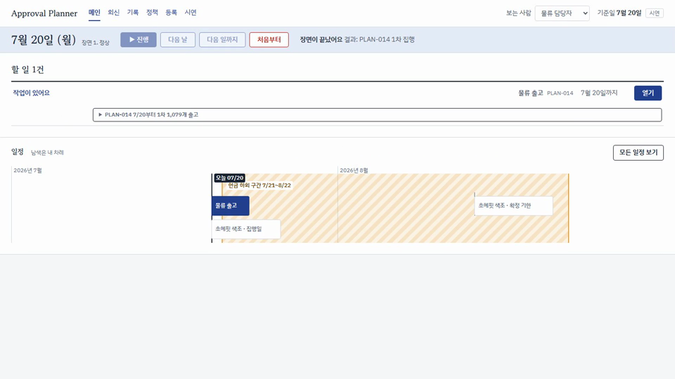

# Approval Planner

승인이 없으면 기본은 거부하는 결재 운영 시스템 — AX 인재전쟁 ONLINE · 삼일PwC 예선 제출작 (2026.11.10 ~ 11.15, 1인)



- 배포: https://approval-planner-arlb.axhub.app
- 포트폴리오: [작업노트/포트폴리오_ApprovalPlanner.pdf](작업노트/포트폴리오_ApprovalPlanner.pdf)
- 시연 영상: [작업노트/ApprovalPlanner_시연영상.mp4](작업노트/ApprovalPlanner_시연영상.mp4)

## 무엇을 하나

결재가 늦어지면 무응답이 곧 결정(계약 자동 갱신 · 기안 자동 확정)이 되는 구조를 **"승인이 없으면 기본은 거부"**로 뒤집고, 기한 전에 시스템이 먼저 움직이게 만들었습니다.

- 원본 주문 · 반품 · 원가 · 현금 데이터로 돈의 흐름을 다시 계산 (실질 ROAS, 비용 분해, 일별 현금, 재고 장부)
- **규칙**이 승인권자 · 기한 · 수량을 정함 — 같은 입력에는 항상 같은 답
- **AI**는 부서 회신 · 고객 리뷰 해석과 브리핑 · 통보 초안 작성만 맡음
- **사람**이 승인 · 분할 승인 · 거절 · 상신을 누름
- 기본 거부는 해지가 아니라 조건변경 통보 초안과 확정 보류

## 구조

| 폴더 | 내용 |
|---|---|
| `backend/app/calc` | 돈의 흐름 계산 (실질 ROAS, 현금 하회 구간, 반품률, 재고) |
| `backend/app/rules` | 승인권자 판정, 기한 · 기본 거부, 분할, 2차 보류 |
| `backend/app/ai` | 회신 · 리뷰 해석, 브리핑 · 통보 초안 |
| `backend/app/engine` · `store` · `api` | 상태 변경 · 저장 · FastAPI |
| `backend/policy.toml` | 한도 · 기한 · 통계 기준 등 정책 값과 출처 |
| `frontend` | React 19 · TypeScript · Vite 화면 |
| `eval` | AI 모델 평가 (8개 모델 × 문제 60개 × 3회) |
| `tools/check_hardcode.py` | 코드 속 숫자를 막는 자동 검사 |
| `작업노트` | 설계 · 구현 계획 · 모델 평가 보고서 · 제출 문서 |
| `01_참가자_배포용` | 대회 주최 측이 배포한 문제지와 원본 데이터 (가상 기업 자료) |

기술: Python 3.11 · FastAPI · SQLite · React 19 · TypeScript · Vite · pytest · Vitest · Playwright

## 실행

```bash
# 서버 (기본은 가짜 AI. 실제 모델은 AXWAR_AI=real 과 API 키)
cd backend
uv run --python 3.11 uvicorn app.api.main:build_app --factory --port 8000

# 화면 (다른 터미널, /api 는 8000 번으로 전달)
cd frontend
npm install
npm run dev
```

시험: `cd backend && uv run pytest` / `cd frontend && npm test`

## 만든 방식

- 문제 정의, 업무 규칙, 판단 기준은 직접 정하고, 구현은 AI 코딩 에이전트(Claude Code)와 함께 했습니다.
- 이슈 → PR → 검토 → 병합, 실패하는 시험을 먼저 쓰고 구현했습니다.

<details>
<summary>대회 폴더 안내 (원래 README)</summary>

이 폴더가 프로젝트 루트예요. 문제 자료와 내 프롬프트 기록 설정이 함께 들어 있어요.

## 시작하기
1. 이 폴더(이 README.md 가 있는 폴더)를 AI 도구에서 프로젝트(작업 공간)로 열어요. 하위 폴더가 아니라 **이 폴더**를 열어야 기록이 수집돼요.
2. 처음 열 때 한 번 승인해요.
   - Claude Code: 폴더 신뢰 창에서 신뢰를 골라요. 데스크톱 앱은 새 세션을 만들 때 이 폴더를 작업 폴더로 골라요.
   - Codex CLI: 「Hooks need review」 창에서 Trust all and continue.
   - Codex 데스크톱 앱: 창이 뜨지 않아요. 설정 > Hook > 프로젝트에서 제공 > 모두 신뢰.
   - Codex VS Code 확장: 창이 뜨지 않아요. Codex 패널 톱니바퀴 > Codex settings > Hooks > From Projects > Trust all.
   - Antigravity: 승인할 것이 없어요. 사이드바의 Create Project 에서 이 폴더를 골라 열어요.
   신뢰한 뒤에는 새 대화를 열어요. 이미 열려 있던 대화는 예전 설정을 계속 써요.
3. 테스트 프롬프트(예: 안녕하세요)를 보내고, 참가 페이지 「문제 풀이 환경 › 기록 연결 확인」의 최근 프롬프트에 그 문장이 보이는지 확인해요.
   AI 도구를 이 폴더를 받기 전부터 켜 두었다면 재시작해요(도구는 시작할 때 설정을 읽어요).

## 꼭 지켜 주세요
- 풀이부터 앱 개발까지 이 폴더에서 해요. 다른 폴더에서 나눈 대화는 수집되지 않아요.
- .claude · .codex · .agents 폴더와 .gitignore 는 지우거나 고치지 마세요. 참가 신청에 묶인 개인 기록 키가 들어 있어 다른 사람과 나누면 안 돼요.
- 소스코드를 zip 으로 낼 때는 이 세 폴더를 빼고 묶어요.
- 기록은 기기가 아니라 기록 키로 모여요. 다른 기기에서 작업하면 이 폴더를 그대로 옮기거나 그 기기에서 다시 내려받아요.
- 이 폴더는 Windows 용이에요. Mac 에서 작업하려면 Mac 용으로 다시 내려받아요.
- Windows 는 C:\axwar 처럼 짧은 경로에 풀어요. 깊은 폴더에 풀면 경로가 260자를 넘는 자료 파일이 빠져요.
- Codex 를 처음 열면 「Set up the Codex agent sandbox」 창이 떠요. 관리자 권한이 있으면 관리자 설정, 없으면 non-admin 을 골라요.

</details>
