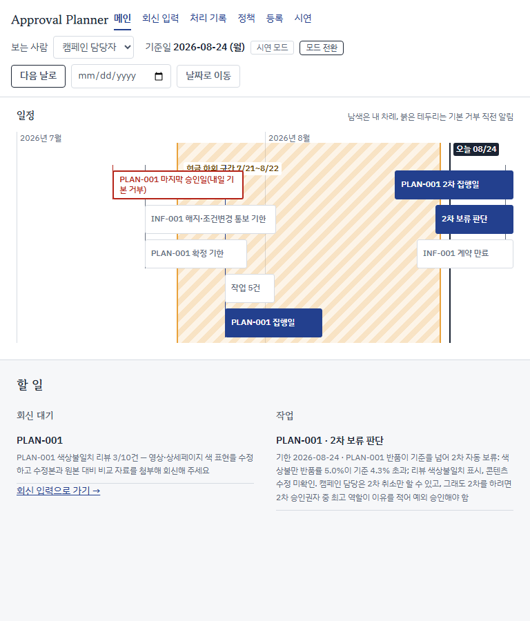
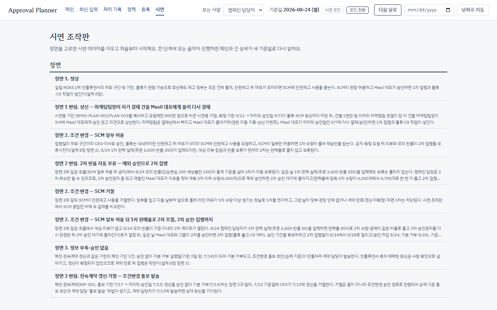
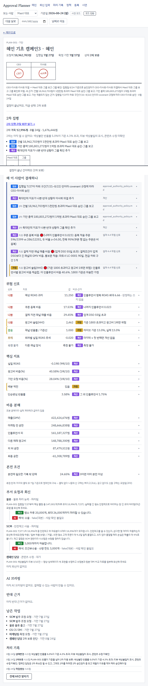
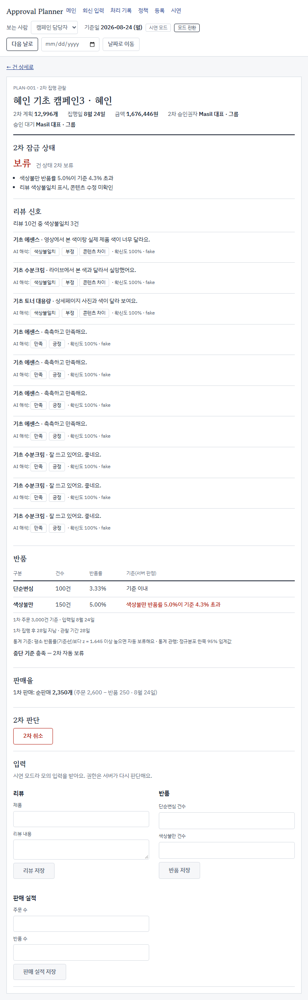
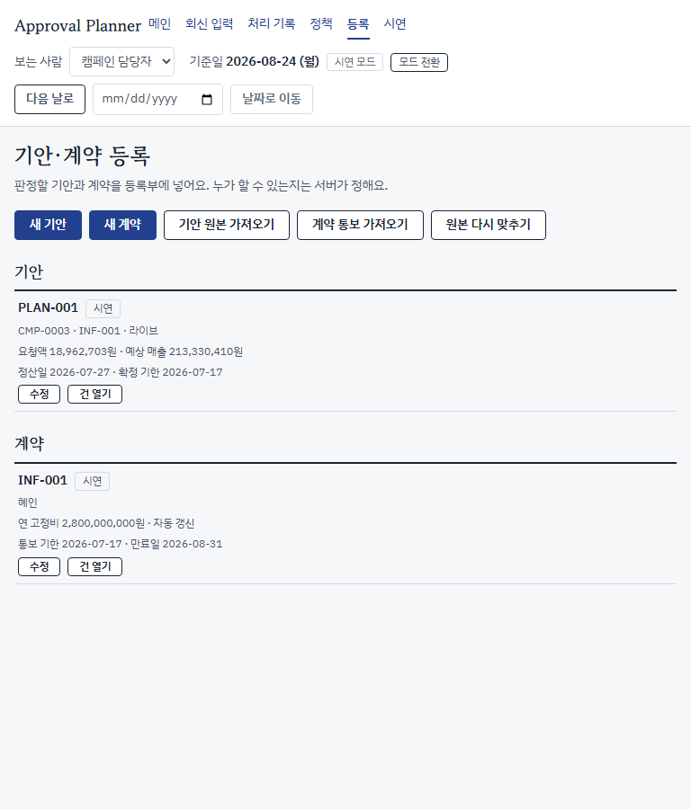
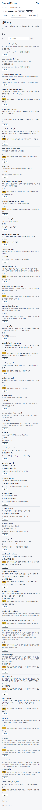

# W02 화면 디자인 리뷰

- 날짜: 2026-11-13
- 범위: 메인, 건 상세, 회신 입력, 2차 관찰, 시연 조작판, 처리 기록, 정책, 등록 (8개 화면)
- 방법: Playwright로 1440·768·390px 전체 화면을 찍고(`e2e/review.spec.ts`, `REVIEW_SHOTS=1 npm run e2e -- review`), 코드 검색과 키보드 시험을 같이 했다. 스크린샷은 `작업노트/화면확인/리뷰_<화면>_<폭>.png` 24장.

## 8항목 점검 결과

| 항목 | 확인 방법 | 결과 | 고친 것 |
|---|---|---|---|
| 레이아웃 균형 | 8개 화면 x 3개 폭 스크린샷 비교 | 1440·768·390 모두 짜임새 유지. 시연 조작판의 장면 8개 설명이 길어 목록이 세로로 매우 길었음 | 장면 설명을 두 줄로 줄이고(전체는 마우스를 올리면 보임), 고른 장면의 전체 설명은 진행 칸 위에 보이게 함 |
| 타이포그래피 | 글자 크기·굵기를 CSS에서 검색 | `font-size`·`font-weight`가 모두 토큰(`--t-*`, `--w-*`). 토큰 밖 값 없음 | 없음 |
| 색상 일관성 | `#색`·`rgb()`를 토큰 파일 밖에서 검색, 배지 색 화면별 비교 | 토큰 밖 색 0건. 근거 배지 색(원본·계산·가정)이 건 상세·2차·기록에서 같음 | 메인의 "회신 입력으로 가기" 링크가 브라우저 기본 파랑이라 토큰 남색으로 바꿈 |
| 컴포넌트 간격 | 간격 값을 CSS에서 검색 | `padding`·`gap`·`margin`이 모두 간격 토큰. 화면 안에서만 쓰는 값(선 굵기 등)은 해당 CSS 맨 위에 이름을 붙여 둠 | 없음 |
| 시각적 위계 | 건 상세에서 규칙 판정·기한·결정 버튼이 먼저 보이는지 | 결재란, 기본 거부 날짜, 결정 칸 순서가 맞음. 승인 버튼이 가장 진함 | 올림 문구 "마케팅팀가 올림"의 조사 오류를 "마케팅팀에서 올림"으로 바꿈(할 일 칸) |
| 반응형 동작 | 3개 폭에서 `scrollWidth - clientWidth` 측정, 768px 태블릿 폭 확인 | 24장 모두 가로 스크롤 0. 768px에서 위쪽 막대가 세 줄로 접히지만 모두 보이고 눌림 | 기안 25건처럼 긴 목록에 찾기 칸 추가(8건 넘으면 보임) |
| 접근성 | Tab 45번씩 7개 화면 이동하며 초점 표시 검사, 흐린 글씨 토큰 대비 확인, 버튼 이름 확인 | 흐린 글씨 토큰은 흰 바탕 대비 4.5:1 이상. 버튼에 모두 이름 있음. 위쪽 막대의 날짜 입력 칸은 초점 테두리가 없었음 | 날짜 칸에 초점 테두리(`:focus-within`) 추가 후 7개 화면 모두 통과 |
| 인터랙션 완성도 | 장면 시험 4개를 화면 클릭만으로 끝까지, 콘솔·서버 오류 수집 | 장면 1·2·3·상신 모두 통과, 오류 0. 빈 상태·불러오는 중·실패 문장은 화면 시험(vitest)에서 확인됨 | 없음 |

## 스크린샷 (고친 뒤)

## 남은 문제

- 메인 일정 그림: 붉은 "마지막 승인일" 상자가 "현금 회수 구간" 글씨를 일부 가린다(1440·768). 일정 배치 계산(`timelineLayout.ts`) 손질이 필요해 이번엔 두었다.
- 768px 위쪽 막대가 세 줄로 접힌다. 보는 사람·기준일·이동 도구를 묶는 재배치는 하지 않았다.
- 서버 문장(건 상세 변경 기록)에 "마케팅팀가 올림" 같은 조사 오류가 있다. 백엔드 문구라 화면에서 고치지 않았다.
- 처리 기록은 이벤트가 70건이 넘으면 휴대폰 폭에서 매우 길다(50개씩 더 보기 있음).
- 2차 관찰의 리뷰 목록은 리뷰 수만큼 길어진다(접기 없음).
