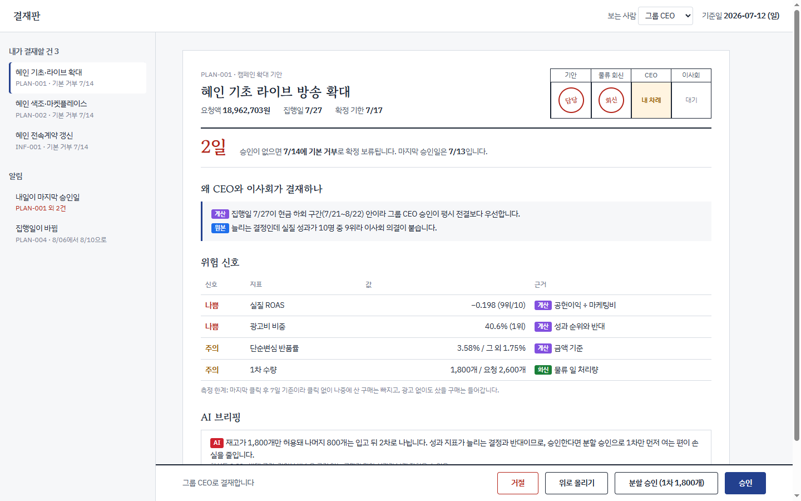
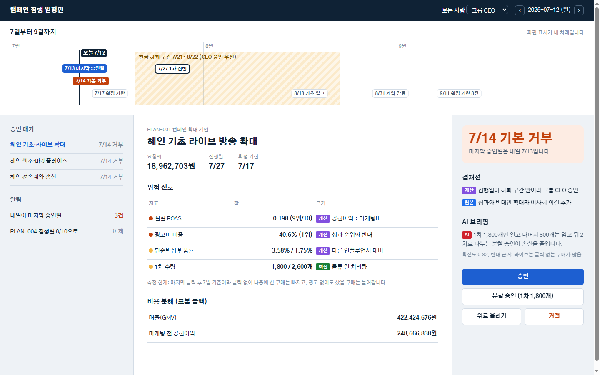
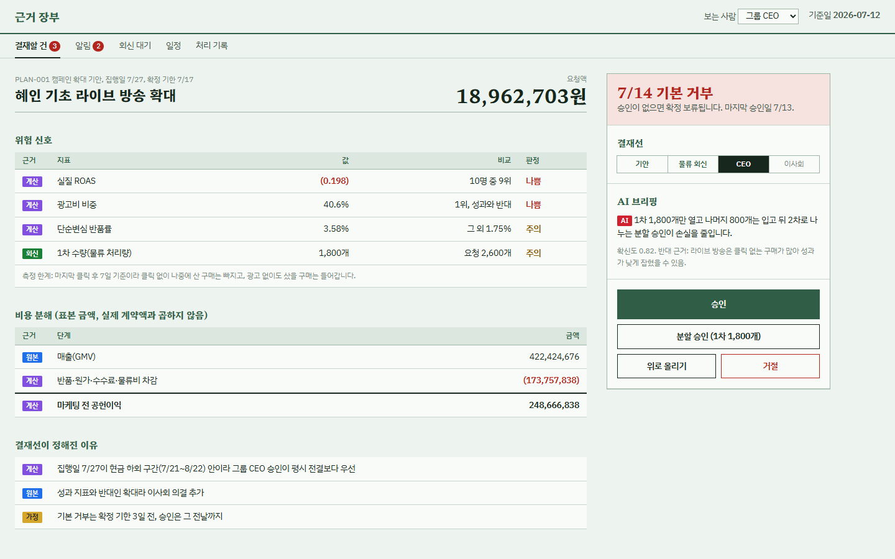
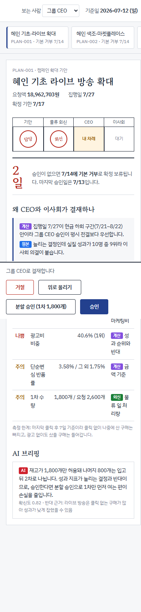
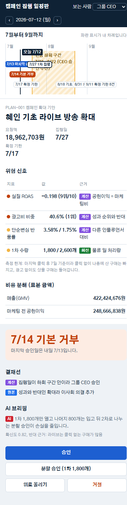
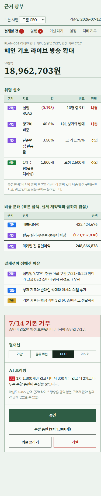

# 화면 디자인 방향 고르기

## 결정 (사용자, 2026-11-12)

- **A 결재판 + B 일정 띠**: 건 상세·할 일·결정 막대는 A 결재판. 메인 화면의 달력은 B처럼 하회 구간 빗금과 오늘 선이 있는 일정 띠. 색과 글꼴은 A를 따른다.
- **근거를 누르면 자세히 본다**: 위험 신호·결재선 이유·비용 분해의 각 줄을 누르면(휴대폰은 터치) 그 줄 바로 아래가 펼쳐져 계산식, 입력값, 원본 파일, 쓰인 정책 값(가정이면 출처와 이유)이 보인다. 다시 누르면 접힌다. 키보드로도 연다.
- 휴대폰 폭에서 일정 띠는 날짜 목록으로 바뀐다(B 시안에서 글자가 겹친 문제).
- 토큰: `frontend/src/design/tokens.css`. 근거 상세에 필요한 서버 응답은 아직 없어 `backend-core`에 근거 상세 API를 먼저 붙인다.

- 만든 날: 2026-11-12
- 쓰임: 6단계 화면을 만들기 전에 방향 하나를 고릅니다. 고른 방향으로 토큰(글꼴·크기·색·간격)을 정하고 모든 화면에 씁니다.
- 세 시안은 **같은 내용**입니다. 그룹 CEO가 7/12에 혜인 기초 라이브 확대 기안(PLAN-001)을 결재하는 화면입니다.
- 시안 파일: `작업노트/디자인_방향/시안A_결재판.html`, `시안B_일정판.html`, `시안C_장부.html` (브라우저로 열면 버튼·선택 상자 모양까지 볼 수 있음. 아직 동작은 없음)

## 세 시안이 함께 지키는 것

- 근거 배지 6색은 설계 PDF와 같습니다: [원본] [계산] [가정] [회신] [의견] [AI]
- 승인권자가 가장 먼저 봐야 할 것 세 가지를 위에 둡니다: **기본 거부까지 남은 날**, **왜 이 사람이 결재하는지**, **결정 버튼**.
- 버튼은 승인 / 분할 승인 / 위로 올리기(상신) / 거절 네 개입니다. 승인권자가 아니면 버튼 대신 "승인권자: OOO"가 나옵니다.
- 측정 한계 문장은 위험 신호 바로 아래에 둡니다.
- 하지 않을 것: 같은 모양 카드를 줄지어 놓기, 그라데이션 장식, 영문 대문자 꼬리표, 숫자 큰 글씨+작은 설명을 반복하는 지표 타일, 등장 애니메이션.

## 시안 A. 결재판

- 무드: 회사에서 실제로 돌리는 결재 서류. 흰 종이 위 남색 글씨, 도장 인주색 빨강은 **결재 도장과 거부에만** 씁니다.
- 기억에 남을 한 가지: 오른쪽 위 **결재란**. 결재가 끝난 칸에 도장이 찍히고, 내 차례 칸이 노랗게 표시됩니다. 상신하면 칸이 바뀌고, 권한이 이동하면 칸 이름이 바뀝니다.
- 글꼴: 제목 고운바탕(명조 계열), 본문·숫자 IBM Plex Sans KR.
- 배치: 왼쪽 할 일 목록, 가운데 서류, 아래쪽에 결정 막대가 고정됩니다.
- 좋은 점: 한국 회사 사람이 설명 없이 읽습니다. 이 시스템의 중심인 "누가 언제까지 결재하나"가 한눈에 보입니다.
- 약한 점: 일정(하회 구간, 입고일)은 이 화면에 없고 메인의 달력에서만 보입니다.

## 시안 B. 일정판

- 무드: 관제 화면. 맨 위 **7월~9월 일정 띠**가 화면의 주인입니다.
- 기억에 남을 한 가지: 빗금 친 **현금 하회 구간**과 오늘 선. 집행일 점이 빗금 안에 들어가면 왜 CEO가 결재하는지 바로 보입니다. 내 차례 일정만 파랗게 칠합니다.
- 글꼴: Gothic A1 하나(굵기로 위계).
- 배치: 위 일정 띠, 아래 세 칸(할 일, 건 내용, 결정 칸 고정).
- 좋은 점: 기한·집행일·하회 구간·입고일의 관계가 그림으로 보입니다. 집행일이 바뀌거나 2차로 밀리는 것도 점이 움직이는 것으로 보입니다.
- 약한 점: 휴대폰 폭에서는 일정 띠가 좁아 글자가 겹칩니다(아래 그림). 만들 때는 휴대폰에서 날짜 목록으로 바꿔야 합니다.

## 시안 C. 근거 장부

- 무드: 회계 장부. 연한 녹색 종이, 줄 친 표, 음수는 회계식 빨간 괄호 (0.198).
- 기억에 남을 한 가지: 모든 근거가 **장부 한 줄**이고 맨 앞 칸이 배지입니다. 원본과 계산·가정이 세로로 줄지어 구분됩니다(완성 조건 "원본과 가정 분리"가 화면 모양 자체).
- 글꼴: 제목 함렛, 본문·숫자 IBM Plex Sans KR.
- 배치: 위쪽 탭(결재할 건, 알림, 회신 대기, 일정, 처리 기록), 왼쪽 장부, 오른쪽 결정 칸 고정.
- 좋은 점: 숫자를 많이 보여 줘도 정돈돼 보입니다. 삼일PwC 심사위원에게 익숙한 말투입니다.
- 약한 점: 표가 많아 처음 보는 사람에게 딱딱합니다. 결재선 변화가 A만큼 눈에 띄지 않습니다.

## 휴대폰 폭(390px)

| A 결재판 | B 일정판 | C 근거 장부 |
|---|---|---|
|  |  |  |

## 추천

**A 결재판**을 추천합니다. 이 시스템이 하는 일의 중심이 "누가, 언제까지 결재하나, 안 하면 기본 거부"이고, 상신·권한 이동·분할 승인이 모두 결재란 칸의 변화로 보이기 때문입니다. 메인 화면의 달력은 A의 색과 글꼴로 B처럼 하회 구간 빗금을 넣어 만들 수 있습니다.

## 시안에 넣은 예시 값 [가정]

- 1차 1,800개 / 요청 2,600개, 물류 회신, AI 확신도 0.82와 브리핑 문장, 알림 두 줄(PLAN-004 집행일 8/10)은 **모양을 보이려고 넣은 예시**입니다. 실제 화면은 서버 응답 값을 그대로 씁니다.
- 나머지 숫자(요청액, 집행일, 확정 기한, 하회 구간 7/21~8/22, 실질 ROAS −0.198 9위, 광고비 비중 40.6%, 반품률 3.58%/1.75%, 비용 분해)는 설계 문서의 원본·계산 값입니다.
