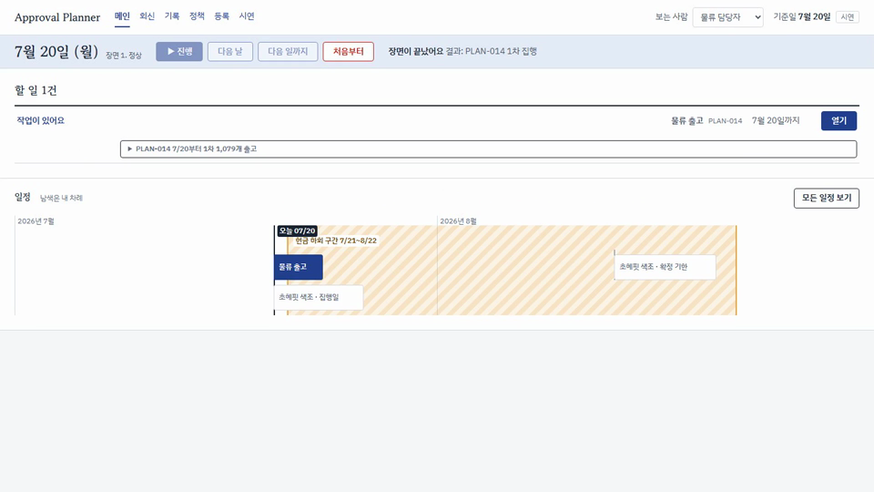
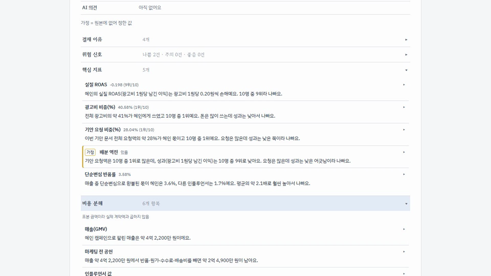
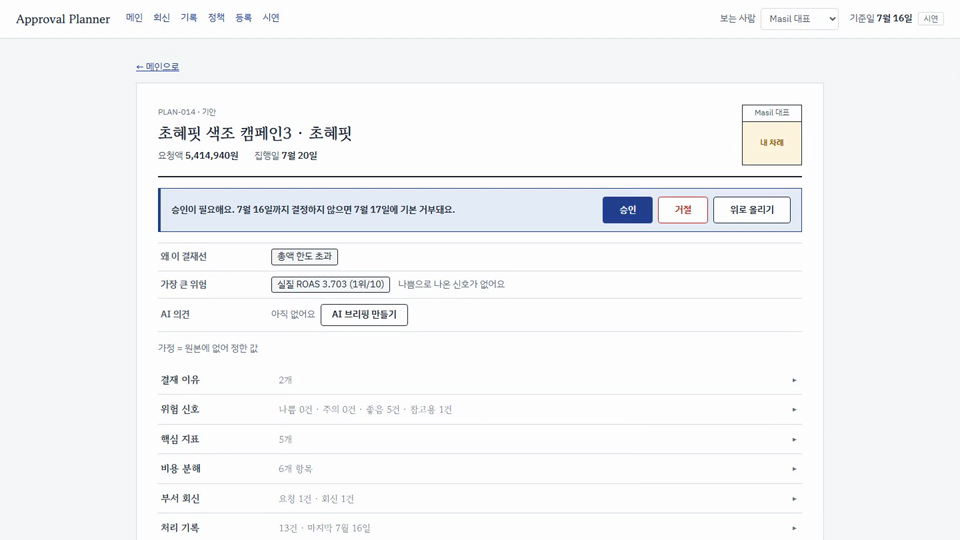
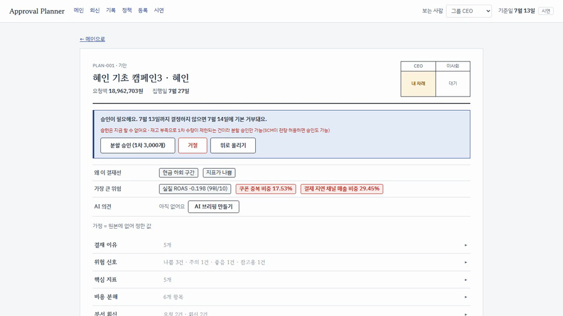
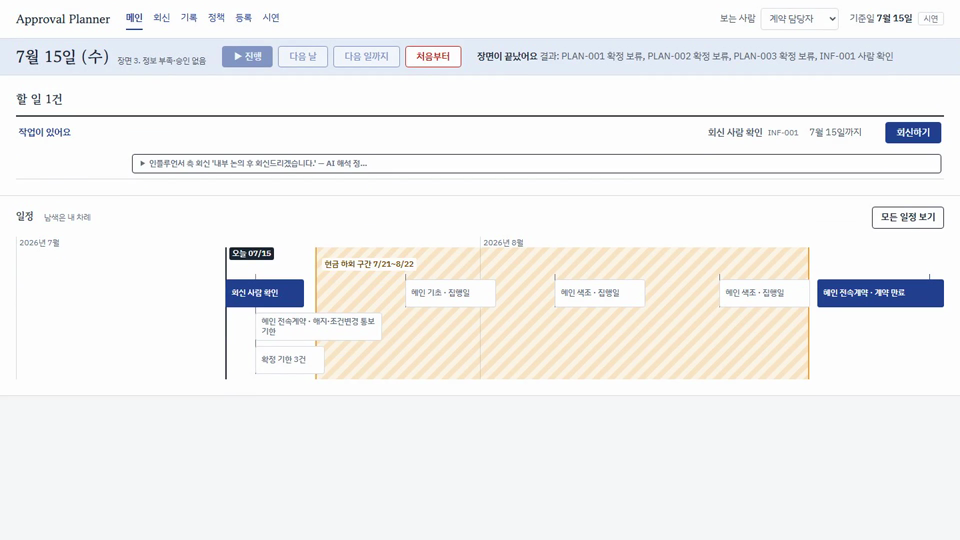

# Approval Planner — 승인이 없으면 기본은 거부하는 결재 운영 시스템

- 대회: AX 인재전쟁 ONLINE · 삼일PwC 예선 (2026-11-10 ~ 11-15, 6일)
- 과제: 가상 기업 Aurora Holdings 자료로 AI 기반 운영 시스템 만들기 — 고른 업무 W02 "인플루언서 계약·캠페인 집행"
- 역할: 기획·업무 규칙 결정·설계 검토·시연 (1인). 구현은 AI 코딩 에이전트(Claude Code)와 함께, 규칙과 판단 기준은 모두 직접 정함
- 결과물: 웹 서비스 배포(https://approval-planner-arlb.axhub.app), 시연 영상 4분 40초, 설계 설명 7문항

---

## 1. 한 줄 요약

결재가 늦어지면 **무응답이 곧 결정**(계약 자동 갱신·기안 자동 확정)이 되는 구조를, **"승인이 없으면 기본은 거부"**로 뒤집고 기한 전에 시스템이 먼저 움직이게 만든 결재 운영 시스템.

## 2. 문제

Masil(화장품 자회사)의 마케팅팀·대표·그룹 CEO·이사회가 두 가지를 결정해야 했다.

| 결정 | 기한을 놓치면 |
|---|---|
| 혜인 전속계약(연 고정 28억) 갱신 여부 | 7/17까지 통보가 없으면 1년 자동 갱신, 갱신 뒤 해지는 잔여 금액 50% 위약금 |
| 캠페인 확대 기안 25건(1억 8,080만 원) 승인 여부 | 확정 기한이 지나면 자동 확정, 철회 불가 |

어려운 이유
1. **판단 지연이 곧 결정** — 승인권자가 못 보면 그대로 갱신·확정된다.
2. **정보 공백** — 재무팀 메모대로 혜인의 실질 공헌이익은 계산된 적이 없었다.
3. **승인권자가 조건마다 바뀜** — 금액, 현금 하회 구간(7/21~8/22, 30억 미만), 지표와 반대인 결정인지에 따라 전결 → 대표 → CEO·이사회로 올라간다.
4. **부서 충돌** — 캠페인을 늘리면 물류 처리량·SCM 안전재고·CS 반품이 한꺼번에 흔들린다.

## 3. 핵심 발견 — 매출이 아니라 순액으로 보니 순위가 뒤집혔다

원본 주문·반품·원가·수수료·광고비를 주문 단위로 다시 계산했다.

- 혜인의 **실질 ROAS −0.198, 10명 중 9위**인데 광고비 비중은 **40.6%로 1위**. 성과가 나쁜 곳에 돈이 가장 많이 가는 **배분 역전**.
- 재무팀 공식 전망은 "13주 내내 54.7억 이상, 하회 없음". 일별 현금을 다시 합산하니 **7/21~8/22에 최저 약 19.2억**까지 내려갔다. 차이 원인(발주 대금 37.5억 일시 유출, 결제조건 45→90일 변경 미반영)을 찾아, 공식 전망은 사실이 아니라 **작성자의 의견**으로 구분해 보여 준다.
- 주문 행에 수량이 없어 "주문 1건 = 1개"로 가정했다. 혜인에게 가장 유리한 가정인데도 실질 ROAS가 음수였다.

**내 경험에서 온 설계**: 작곡·사운드 엔지니어로 음원 정산을 겪었다. 음원 수익은 플랫폼 몫과 공제액을 먼저 빼고 나눈다. 인플루언서 성과 값을 총매출로 주면 반품·쿠폰·수수료로 사라진 돈까지 보상하게 된다. 그래서 재협상안의 성과 값 기준을 **공제 후 순액**으로 바꿨다.

## 4. 해결 — 시스템이 하는 일

| 단계 | 하는 일 |
|---|---|
| 승인권자 판정 | 규칙이 결재선을 정하고 이유·규정·근거를 남김(하회 구간 → CEO·이사회, 지표 반대 → 이사회 의결 추가) |
| 부서 확인 | 물류·SCM에 처리량·안전재고 사용 요청을 자동 생성, 회신을 AI가 해석(불명확하면 사람 확인) |
| 재고 계산 | 재고 장부로 1차에 낼 수 있는 수량 계산 → 부족하면 **분할 승인만 허용** |
| 기한 관리 | 5일 전 조기 경고, 마지막 승인일 알림, 2일 방치 시 상급자로, 상신 가능 |
| 기본 거부 | 확정 기한과 1차 집행일 중 이른 날의 3일 전 실행. 계약은 해지가 아니라 **조건변경 통보 초안**, 기안은 확정 보류 |
| 2차 집행 | 1차 뒤 판매율·반품 통계(한쪽 95%)를 보고 2차 자동 보류·축소, 최고 승인권자 예외 승인 |
| 할 일 | 13개 역할마다 할 일·알림·작업을 만들고, 날짜가 바뀌면 관련 부서에 알림 |

**왜 해지가 아니라 조건변경 통보인가**: 승인권자가 사정이 있어 못 봤을 수 있고, 해지하면 이후 협상이 어렵다. 기본 거부는 "멈춤"이지 "끝"이 아니게 했다.

## 5. AI는 어디까지 맡는가

- **AI가 하는 일**: 부서 회신 해석, 리뷰 해석(사유·감정·색 차이), 승인권자 브리핑과 반대 근거, 조건변경 통보 초안.
- **AI가 하지 않는 일**: 승인권자·기한·수량. 규칙이 정해서 매번 같은 답이 나온다.
- **사람이 누르는 곳**: 승인·분할 승인·거절·상신(모두 확인 창), AI 해석 확인, 통보 발송, 예외 승인.
- **모델 선정**: 8개 모델에 문제 60개를 3번씩 풀게 해 평가. 기준은 ① 위험한 오답 0건(사람 확인이 필요한 회신을 놓치지 않기) ② 3회 같은 답 ③ 정확도 ④ 비용. 회신 해석은 Claude Haiku가 위험 오답 0건·전부 정답 87%·1천 건당 $0.16. 확신도는 틀린 답에서도 높게 나와 판단 기준에서 뺐다.

## 6. 계속 쓰는 서비스로 만든 장치

- **하드코딩 금지**: 한도·기한 여유일·통계 기준·역할 이름 43개를 설정에 두고, 값마다 출처를 적음. 원본에 없는 값은 "가정"과 이유를 남김. 자동 검사 도구로 코드 속 숫자를 막음.
- **근거 펼쳐 보기**: 근거 줄을 누르면 계산식·입력값·원본 파일·정책 값이 나와, 승인권자가 숫자를 스스로 확인.
- **정책 화면**: 규정이 바뀌면 화면에서 이유를 적어 바꾸고 이력이 남음. 코드 수정 불필요.
- **운영·시연 모드 분리**, 기안·계약 등록과 CSV 가져오기.
- **원본 데이터와 가정 분리**: 화면에 [가정], [AI] 표시.

## 7. 만든 방식

- 기술: Python 3.11·FastAPI(서버), React 19·TypeScript·Vite(화면), SQLite, axhub 배포
- 진행: 6일, 이슈 23개·PR 22개. 모듈별 브랜치, 이슈 → PR → 검토 → 병합
- 품질: **테스트 먼저**(실패하는 시험을 먼저 쓰고 구현). 서버 시험 1,024개, 화면 시험 261개, 시연 장면을 실제로 클릭해 끝까지 도는 브라우저 시험 9개
- AI 협업: 구현·검토를 AI 에이전트에 나눠 맡기고, 업무 규칙(기본 거부 방식, 분할 기준, 2차 일정, 부서 회신 처리 등)은 매번 내가 결정. 에이전트가 가정으로 정한 값은 모두 보고받아 확인
- 시연 영상: 녹화·편집·자막·해설 음성까지 스크립트로 자동화(날짜 진행 구간은 8배 빨리 감기 표시)

## 8. 배운 점과 다음 단계

- **기본값이 결정이다**: 아무것도 안 했을 때 무슨 일이 일어나는지를 먼저 설계해야 한다. 이 시스템의 핵심은 기능이 아니라 기본값을 "거부"로 바꾼 것이다.
- **숫자는 출처와 함께**: 같은 회사 안에서도 재무팀 전망과 원장 합산이 달랐다. 사실과 의견을 나눠 보여 주는 것이 판단을 돕는다.
- **AI는 해석, 규칙은 결정**: 결과가 흔들리면 안 되는 부분은 규칙에 두고, AI는 사람 말을 읽는 데 썼다.
- 다음 단계(설계만 됨): 재시작해도 남는 PostgreSQL 저장, 회사 로그인 연동, 실제 메일·사내 시스템 연결, 실제 AI 모델 연결.

---

- 앱: https://approval-planner-arlb.axhub.app
- 코드: GitHub e9on/axwar
- 영상: ApprovalPlanner_시연영상.mp4
